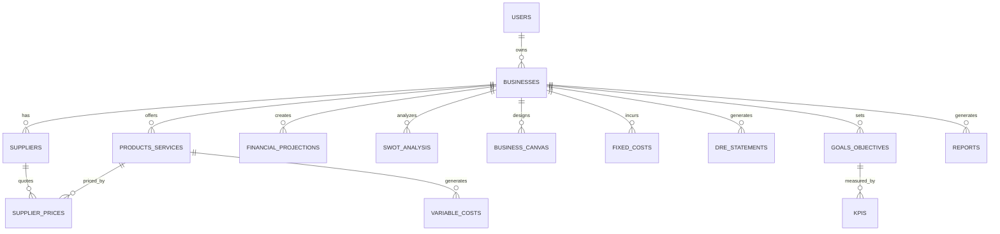

# Diagrama do Banco de Dados - Sistema SaaS de Planejamento de Negócios

## Visão Geral

O banco de dados é estruturado para suportar múltiplas empresas por usuário, com módulos independentes mas interconectados para gestão completa do planejamento de negócios.

## Estrutura das Tabelas

### 🔐 Módulo de Autenticação

#### users
```sql
CREATE TABLE users (
    id UUID PRIMARY KEY DEFAULT gen_random_uuid(),
    email VARCHAR(255) UNIQUE NOT NULL,
    hashed_password VARCHAR(255) NOT NULL,
    first_name VARCHAR(100) NOT NULL,
    last_name VARCHAR(100) NOT NULL,
    phone VARCHAR(20),
    is_active BOOLEAN DEFAULT TRUE,
    is_verified BOOLEAN DEFAULT FALSE,
    created_at TIMESTAMP DEFAULT CURRENT_TIMESTAMP,
    updated_at TIMESTAMP DEFAULT CURRENT_TIMESTAMP
);
```

#### user_sessions
```sql
CREATE TABLE user_sessions (
    id UUID PRIMARY KEY DEFAULT gen_random_uuid(),
    user_id UUID REFERENCES users(id) ON DELETE CASCADE,
    token_hash VARCHAR(255) NOT NULL,
    expires_at TIMESTAMP NOT NULL,
    created_at TIMESTAMP DEFAULT CURRENT_TIMESTAMP
);
```

### 🏢 Módulo de Negócios

#### businesses
```sql
CREATE TABLE businesses (
    id UUID PRIMARY KEY DEFAULT gen_random_uuid(),
    owner_id UUID REFERENCES users(id) ON DELETE CASCADE,
    name VARCHAR(200) NOT NULL,
    description TEXT,
    segment VARCHAR(100) NOT NULL,
    industry VARCHAR(100) NOT NULL,
    business_type VARCHAR(50) NOT NULL, -- MEI, Ltda, SA, etc.
    cnpj VARCHAR(18) UNIQUE,
    founded_date DATE,
    
    -- Localização
    address TEXT,
    city VARCHAR(100),
    state VARCHAR(50),
    postal_code VARCHAR(10),
    country VARCHAR(50) DEFAULT 'Brasil',
    
    -- Público-alvo
    target_audience TEXT,
    market_size VARCHAR(50),
    
    -- Status
    is_active BOOLEAN DEFAULT TRUE,
    created_at TIMESTAMP DEFAULT CURRENT_TIMESTAMP,
    updated_at TIMESTAMP DEFAULT CURRENT_TIMESTAMP
);
```

### 👥 Módulo de Fornecedores

#### suppliers
```sql
CREATE TABLE suppliers (
    id UUID PRIMARY KEY DEFAULT gen_random_uuid(),
    business_id UUID REFERENCES businesses(id) ON DELETE CASCADE,
    name VARCHAR(200) NOT NULL,
    contact_person VARCHAR(100),
    email VARCHAR(255),
    phone VARCHAR(20),
    cnpj_cpf VARCHAR(18),
    
    -- Endereço
    address TEXT,
    city VARCHAR(100),
    state VARCHAR(50),
    postal_code VARCHAR(10),
    
    -- Informações comerciais
    payment_terms INTEGER, -- dias
    delivery_time INTEGER, -- dias
    minimum_order DECIMAL(12,2),
    
    -- Avaliação
    rating DECIMAL(3,2) CHECK (rating >= 0 AND rating <= 5),
    notes TEXT,
    
    is_active BOOLEAN DEFAULT TRUE,
    created_at TIMESTAMP DEFAULT CURRENT_TIMESTAMP,
    updated_at TIMESTAMP DEFAULT CURRENT_TIMESTAMP
);
```

#### products_services
```sql
CREATE TABLE products_services (
    id UUID PRIMARY KEY DEFAULT gen_random_uuid(),
    business_id UUID REFERENCES businesses(id) ON DELETE CASCADE,
    name VARCHAR(200) NOT NULL,
    description TEXT,
    type VARCHAR(20) NOT NULL CHECK (type IN ('product', 'service')),
    category VARCHAR(100),
    unit VARCHAR(20) NOT NULL, -- unidade, kg, hora, m², etc.
    
    -- Preços
    base_cost DECIMAL(12,2) NOT NULL,
    markup_percentage DECIMAL(5,2) DEFAULT 0.00,
    sale_price DECIMAL(12,2) NOT NULL,
    
    -- Impostos
    tax_percentage DECIMAL(5,2) DEFAULT 0.00,
    
    is_active BOOLEAN DEFAULT TRUE,
    created_at TIMESTAMP DEFAULT CURRENT_TIMESTAMP,
    updated_at TIMESTAMP DEFAULT CURRENT_TIMESTAMP
);
```

#### supplier_prices
```sql
CREATE TABLE supplier_prices (
    id UUID PRIMARY KEY DEFAULT gen_random_uuid(),
    supplier_id UUID REFERENCES suppliers(id) ON DELETE CASCADE,
    product_service_id UUID REFERENCES products_services(id) ON DELETE CASCADE,
    price DECIMAL(12,2) NOT NULL,
    effective_date DATE NOT NULL,
    end_date DATE,
    notes TEXT,
    created_at TIMESTAMP DEFAULT CURRENT_TIMESTAMP
);
```

### 💰 Módulo Financeiro

#### fixed_costs
```sql
CREATE TABLE fixed_costs (
    id UUID PRIMARY KEY DEFAULT gen_random_uuid(),
    business_id UUID REFERENCES businesses(id) ON DELETE CASCADE,
    name VARCHAR(200) NOT NULL,
    description TEXT,
    category VARCHAR(100), -- Aluguel, Salários, Software, etc.
    amount DECIMAL(12,2) NOT NULL,
    frequency VARCHAR(20) NOT NULL, -- monthly, quarterly, yearly
    start_date DATE NOT NULL,
    end_date DATE,
    is_active BOOLEAN DEFAULT TRUE,
    created_at TIMESTAMP DEFAULT CURRENT_TIMESTAMP,
    updated_at TIMESTAMP DEFAULT CURRENT_TIMESTAMP
);
```

#### variable_costs
```sql
CREATE TABLE variable_costs (
    id UUID PRIMARY KEY DEFAULT gen_random_uuid(),
    business_id UUID REFERENCES businesses(id) ON DELETE CASCADE,
    product_service_id UUID REFERENCES products_services(id),
    name VARCHAR(200) NOT NULL,
    description TEXT,
    cost_per_unit DECIMAL(12,2) NOT NULL,
    percentage_of_revenue DECIMAL(5,2),
    created_at TIMESTAMP DEFAULT CURRENT_TIMESTAMP,
    updated_at TIMESTAMP DEFAULT CURRENT_TIMESTAMP
);
```

#### financial_projections
```sql
CREATE TABLE financial_projections (
    id UUID PRIMARY KEY DEFAULT gen_random_uuid(),
    business_id UUID REFERENCES businesses(id) ON DELETE CASCADE,
    name VARCHAR(200) NOT NULL,
    description TEXT,
    
    -- Período da projeção
    start_date DATE NOT NULL,
    end_date DATE NOT NULL,
    
    -- Projeções mensais (JSON para flexibilidade)
    monthly_revenue JSONB, -- [{month: 1, revenue: 10000}, ...]
    monthly_costs JSONB,
    monthly_profit JSONB,
    
    -- Métricas
    break_even_point INTEGER, -- mês
    payback_period INTEGER, -- meses
    roi_percentage DECIMAL(5,2),
    
    created_at TIMESTAMP DEFAULT CURRENT_TIMESTAMP,
    updated_at TIMESTAMP DEFAULT CURRENT_TIMESTAMP
);
```

#### dre_statements
```sql
CREATE TABLE dre_statements (
    id UUID PRIMARY KEY DEFAULT gen_random_uuid(),
    business_id UUID REFERENCES businesses(id) ON DELETE CASCADE,
    period_start DATE NOT NULL,
    period_end DATE NOT NULL,
    
    -- Receitas
    gross_revenue DECIMAL(15,2) NOT NULL,
    taxes_on_sales DECIMAL(15,2) DEFAULT 0,
    net_revenue DECIMAL(15,2) NOT NULL,
    
    -- Custos
    direct_costs DECIMAL(15,2) DEFAULT 0,
    gross_profit DECIMAL(15,2) NOT NULL,
    
    -- Despesas
    operational_expenses DECIMAL(15,2) DEFAULT 0,
    administrative_expenses DECIMAL(15,2) DEFAULT 0,
    selling_expenses DECIMAL(15,2) DEFAULT 0,
    
    -- Resultado
    ebitda DECIMAL(15,2) NOT NULL,
    depreciation DECIMAL(15,2) DEFAULT 0,
    ebit DECIMAL(15,2) NOT NULL,
    financial_result DECIMAL(15,2) DEFAULT 0,
    net_income DECIMAL(15,2) NOT NULL,
    
    created_at TIMESTAMP DEFAULT CURRENT_TIMESTAMP
);
```

### 📊 Módulo Estratégico

#### swot_analysis
```sql
CREATE TABLE swot_analysis (
    id UUID PRIMARY KEY DEFAULT gen_random_uuid(),
    business_id UUID REFERENCES businesses(id) ON DELETE CASCADE,
    name VARCHAR(200) NOT NULL,
    description TEXT,
    
    strengths JSONB, -- Array de strings
    weaknesses JSONB,
    opportunities JSONB,
    threats JSONB,
    
    action_items JSONB, -- Array de objetos com ações
    created_at TIMESTAMP DEFAULT CURRENT_TIMESTAMP,
    updated_at TIMESTAMP DEFAULT CURRENT_TIMESTAMP
);
```

#### business_canvas
```sql
CREATE TABLE business_canvas (
    id UUID PRIMARY KEY DEFAULT gen_random_uuid(),
    business_id UUID REFERENCES businesses(id) ON DELETE CASCADE,
    name VARCHAR(200) NOT NULL,
    
    -- 9 blocos do Canvas
    key_partners JSONB,
    key_activities JSONB,
    key_resources JSONB,
    value_propositions JSONB,
    customer_relationships JSONB,
    channels JSONB,
    customer_segments JSONB,
    cost_structure JSONB,
    revenue_streams JSONB,
    
    created_at TIMESTAMP DEFAULT CURRENT_TIMESTAMP,
    updated_at TIMESTAMP DEFAULT CURRENT_TIMESTAMP
);
```

#### goals_objectives
```sql
CREATE TABLE goals_objectives (
    id UUID PRIMARY KEY DEFAULT gen_random_uuid(),
    business_id UUID REFERENCES businesses(id) ON DELETE CASCADE,
    title VARCHAR(200) NOT NULL,
    description TEXT,
    type VARCHAR(50) NOT NULL, -- financial, operational, strategic, etc.
    
    -- SMART Goals
    target_value DECIMAL(15,2),
    current_value DECIMAL(15,2) DEFAULT 0,
    unit VARCHAR(50),
    deadline DATE,
    
    -- Status
    status VARCHAR(20) DEFAULT 'active', -- active, completed, cancelled
    progress_percentage DECIMAL(5,2) DEFAULT 0,
    
    created_at TIMESTAMP DEFAULT CURRENT_TIMESTAMP,
    updated_at TIMESTAMP DEFAULT CURRENT_TIMESTAMP
);
```

#### kpis
```sql
CREATE TABLE kpis (
    id UUID PRIMARY KEY DEFAULT gen_random_uuid(),
    business_id UUID REFERENCES businesses(id) ON DELETE CASCADE,
    goal_id UUID REFERENCES goals_objectives(id) ON DELETE CASCADE,
    name VARCHAR(200) NOT NULL,
    description TEXT,
    
    -- Configuração do KPI
    calculation_method TEXT, -- Como calcular
    frequency VARCHAR(20), -- daily, weekly, monthly, quarterly
    target_value DECIMAL(15,2),
    
    -- Valores históricos
    historical_data JSONB, -- [{date: "2024-01", value: 1000}, ...]
    
    created_at TIMESTAMP DEFAULT CURRENT_TIMESTAMP,
    updated_at TIMESTAMP DEFAULT CURRENT_TIMESTAMP
);
```

### 📄 Módulo de Relatórios

#### reports
```sql
CREATE TABLE reports (
    id UUID PRIMARY KEY DEFAULT gen_random_uuid(),
    business_id UUID REFERENCES businesses(id) ON DELETE CASCADE,
    user_id UUID REFERENCES users(id) ON DELETE CASCADE,
    
    name VARCHAR(200) NOT NULL,
    type VARCHAR(50) NOT NULL, -- financial, strategic, complete, custom
    format VARCHAR(10) NOT NULL, -- pdf, excel
    
    -- Configuração do relatório
    config JSONB, -- Parâmetros específicos do relatório
    
    -- Arquivo gerado
    file_path VARCHAR(500),
    file_size INTEGER,
    
    generated_at TIMESTAMP DEFAULT CURRENT_TIMESTAMP
);
```

## Relacionamentos Principais



## Índices Recomendados

```sql
-- Performance queries
CREATE INDEX idx_businesses_owner_id ON businesses(owner_id);
CREATE INDEX idx_suppliers_business_id ON suppliers(business_id);
CREATE INDEX idx_products_services_business_id ON products_services(business_id);
CREATE INDEX idx_supplier_prices_supplier_id ON supplier_prices(supplier_id);
CREATE INDEX idx_supplier_prices_product_service_id ON supplier_prices(product_service_id);
CREATE INDEX idx_financial_projections_business_id ON financial_projections(business_id);
CREATE INDEX idx_fixed_costs_business_id ON fixed_costs(business_id);
CREATE INDEX idx_dre_statements_business_id ON dre_statements(business_id);

-- Authentication
CREATE INDEX idx_user_sessions_user_id ON user_sessions(user_id);
CREATE INDEX idx_user_sessions_token_hash ON user_sessions(token_hash);

-- Filtering
CREATE INDEX idx_businesses_is_active ON businesses(is_active);
CREATE INDEX idx_suppliers_is_active ON suppliers(is_active);
CREATE INDEX idx_products_services_is_active ON products_services(is_active);
```

## Observações Técnicas

1. **UUIDs**: Utilizados para maior segurança e distribuição
2. **JSONB**: Para dados semi-estruturados (projeções, configurações)
3. **Timestamps**: Auditoria completa de criação/atualização
4. **Soft Delete**: Campos `is_active` para desativação sem remoção
5. **Validações**: Constraints de check para garantir integridade
6. **Escalabilidade**: Estrutura preparada para sharding por business_id