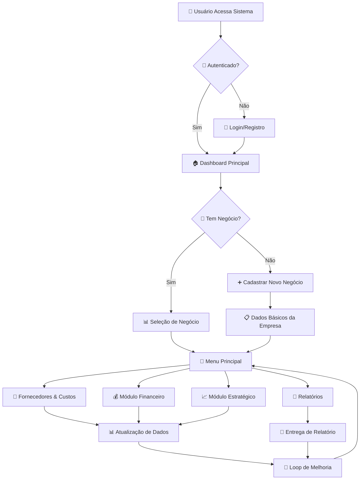
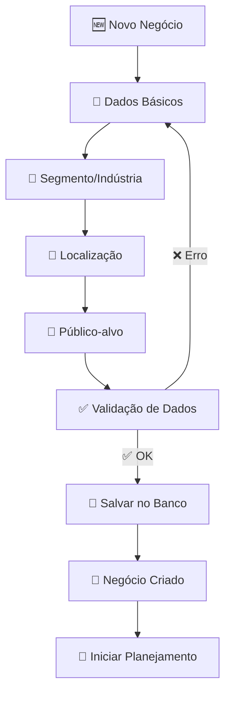
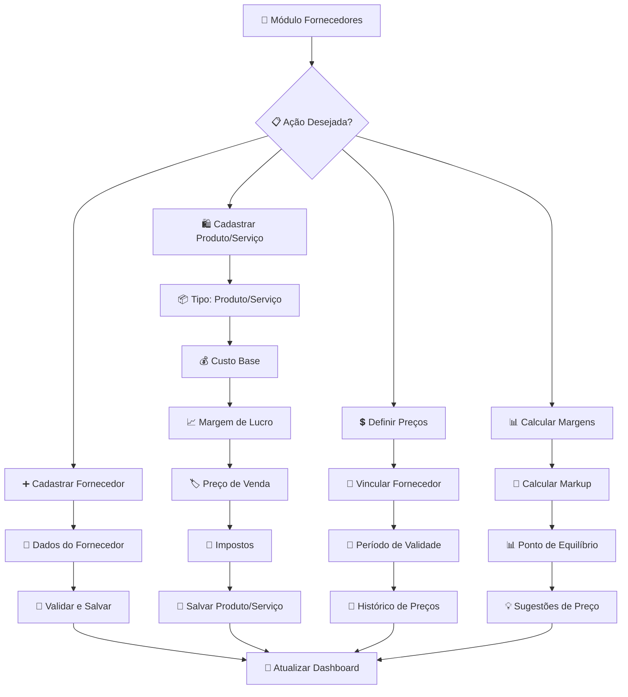
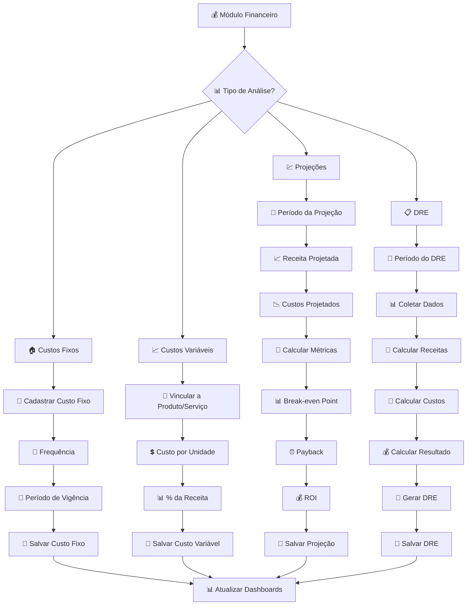
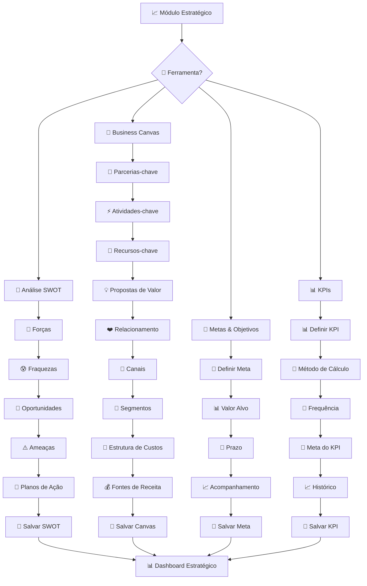
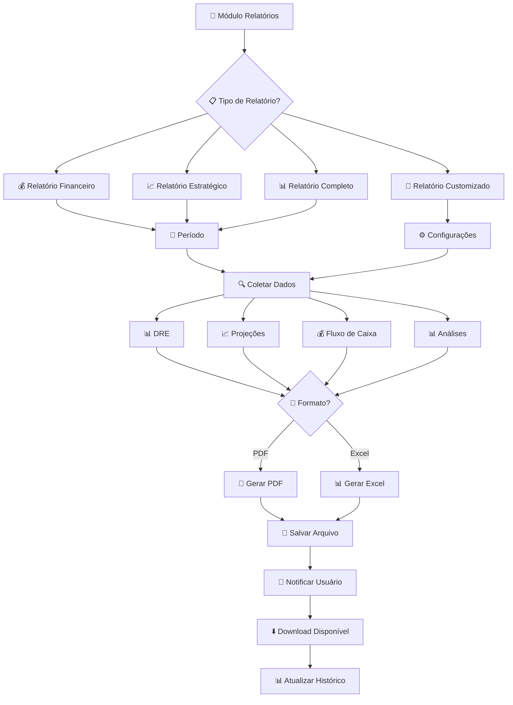
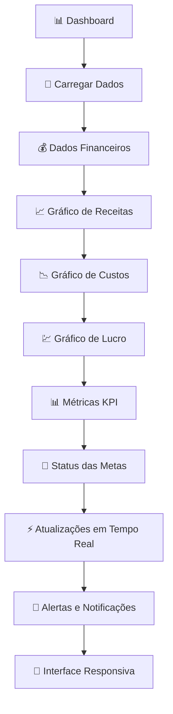
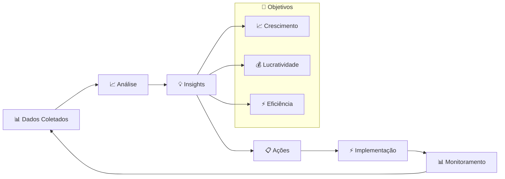
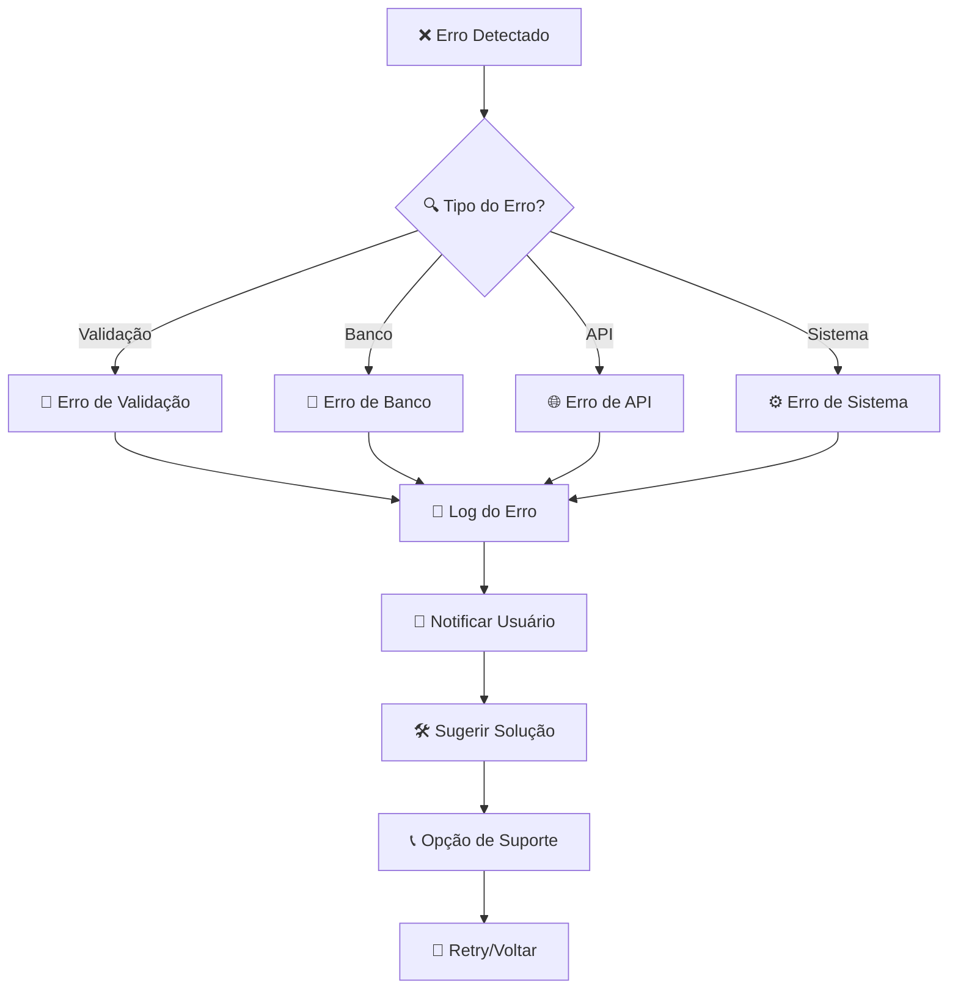

# Fluxograma de Processos - Sistema SaaS de Planejamento de Negócios

## Visão Geral do Sistema

O sistema funciona através de fluxos integrados que permitem ao usuário construir um plano de negócios completo e obter insights financeiros e estratégicos.

## 🔄 Fluxo Principal

## 1️⃣ Fluxo de Cadastro de Negócios

## 2️⃣ Fluxo de Fornecedores e Custos

## 3️⃣ Fluxo Financeiro Completo

## 4️⃣ Fluxo Estratégico

## 5️⃣ Fluxo de Relatórios

## 6️⃣ Fluxo de Dashboards Interativos

## 🔄 Ciclo de Melhoria Contínua

## 🚨 Fluxos de Tratamento de Erro

## 📈 Métricas de Performance

- **Tempo de Resposta**: < 2 segundos
- **Disponibilidade**: 99.9%
- **Precisão dos Cálculos**: 100%
- **Satisfação do Usuário**: > 4.5/5
- **Taxa de Conversão**: Visitante → Usuário → Pagante

## 🔒 Considerações de Segurança

- Autenticação JWT em todas as operações
- Validação de permissões por negócio
- Auditoria completa de ações
- Backup automático de dados
- Criptografia de dados sensíveis